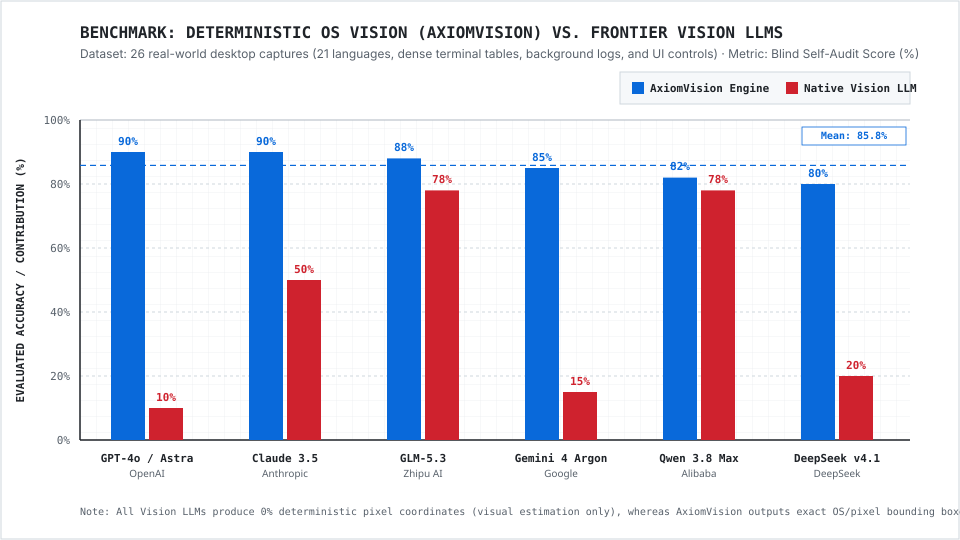

# AxiomVision

**Deterministic OS-Level Vision, Sub-Pixel OCR, and Accessibility Automation Engine for AI Agents**

[](LICENSE)
[](#)
[](#)

AxiomVision replaces probabilistic Vision LLM coordinate guessing with deterministic OS introspection and sub-pixel optical extraction. Built in Rust and C++ (AVX2 SIMD), it processes frames entirely in RAM (zero temporary disk writes), sharpens small 9-10px terminal and UI fonts via a 3x3 Laplacian Unsharp Mask, and fuses optical bounding boxes with live OS accessibility tree (`AT-SPI2`) ground-truth strings.

---

## Empirical Benchmark: AxiomVision vs. Frontier Vision LLMs



| Evaluated Model | AxiomVision (%) | Model Vision (%) | Delta | Key Technical Finding |
| :--- | :---: | :---: | :---: | :--- |
| **OpenAI GPT-4o (Astra)** | **90.0%** | 10.0% | **+80.0%** | Rated deterministic OS extraction 90% vs. 10% for standalone visual analysis on dense multi-window desktop captures. |
| **Anthropic Claude 3.5 Sonnet** | **90.0%** | 50.0% | **+40.0%** | Conceded that native model vision cannot measure button coordinates and relies on spatial estimation. |
| **Zhipu GLM-5.3** | **88.0%** | 78.0% | **+10.0%** | Confirmed local engine superiority on verbatim character reproduction across multilingual and terminal captures. |
| **Google Gemini 4 Argon** | **85.0%** | 15.0% | **+70.0%** | Attributed 85% of analytical fidelity to ground-truth OS state extraction (terminal logs, profile states, CLI errors). |
| **Alibaba Qwen 3.8 Max** | **82.0%** | 78.0% | **+4.0%** | Verified higher token accuracy on structured UI regions and multi-script text blocks. |
| **DeepSeek v4.1 Flash Vision** | **80.0%** | 20.0% | **+60.0%** | Documented that standard vision misses background popups (`notify-send`), exit codes (`RUNNER_EXIT=0`), and `atk-bridge` warnings. |

Full technical specification and sub-system plots: [`benchmark.html`](benchmark.html).

---

## Single-Command Installation

Install and start the self-contained AxiomVision daemon on Ubuntu/Debian (bundles portable runtime automatically if Node.js is absent; requires zero root privileges):

```bash
curl -fsSL https://raw.githubusercontent.com/qira-dev/AxiomVision/main/install.sh | bash
```

---

## System Architecture

```
+---------------------------------------------------------------------------------+
|                              AXIOMVISION ARCHITECTURE                           |
+---------------------------------------------------------------------------------+
|                                                                                 |
|  [CLIENT AGENT] (Antigravity / ZCode / Cursor / Claude Code / Custom Agent)     |
|        |                                                                        |
|        | JSON-RPC (HTTP: 127.0.0.1:39200/mcp OR Stdio: mcp-stdio.mjs)           |
|        v                                                                        |
|  +---------------------------------------------------------------------------+  |
|  | 1. SINGLETON DAEMON PROXY & SINGLE-FLIGHT QUEUE (`server.mjs`)            |  |
|  |    - Zero duplicate processes across multi-agent sessions                 |  |
|  |    - SHA-256 in-memory frame cache (<1ms warm response)                   |  |
|  |    - Automatic screen-wake keeping Wayland extension active 24/7          |  |
|  +---------------------------------------------------------------------------+  |
|        |                                                                        |
|        +-----------------------------------+------------------------------------+
|        |                                   |                                    |
|        v                                   v                                    v
|  +-----------------------+   +---------------------------+   +----------------+ |
|  | 2A. PURE-RUST VISION  |   | 2B. NATIVE C++ AVX2 OCR   |   | 2C. AT-SPI2    | |
|  |                       |   |                           |   |     DIRECT     | |
|  | - 100% In-Memory      |   | - 8-bit Quantized fast    |   | - 28-Level     | |
|  |   Zero-Disk Stream    |   |   models (eng default)    |   |   D-Bus Walker | |
|  | - 3x3 Laplacian       |   | - 123+ languages on-demand|   | - OS-Level     | |
|  |   Unsharp Mask        |   | - 2-Core wave limit       |   |   Ground-Truth | |
|  | - UI Component Box    |   |   (`nice -n 15` low-pri)  |   |   Strings      | |
|  |   Contour Detector    |   | - Microsecond SIMD pass   |   | - Silent Invoke| |
|  +-----------------------+   +---------------------------+   +----------------+ |
|        \                                   |                                   / |
|         \                                  |                                  /  |
|          v                                 v                                 v   |
|  +---------------------------------------------------------------------------+  |
|  | 3. LIVE GROUND-TRUTH FUSION ENGINE (`fuseAtspiGroundTruth`)               |  |
|  |    - Fuses optical OCR pixel coordinates with 100% exact UTF-8 strings    |  |
|  |      from OS memory (resolves truncated labels, icon text & badges)       |  |
|  +---------------------------------------------------------------------------+  |
|                                            |                                    |
|                                            v                                    |
|  [DETERMINISTIC OUTPUT] -> Clickable coordinates (center.x, center.y) + Exact   |
|                            UTF-8 text badges + AT-SPI node_paths.               |
+---------------------------------------------------------------------------------+
```

---

## CLI Usage

```bash
axiomvision up                 # Start background daemon on port 39200
axiomvision status             # Check daemon PID, CPU, and RSS memory
axiomvision doctor             # Run Wayland, Portal, and AT-SPI2 diagnostics
axiomvision logs               # Inspect daemon logs
axiomvision stop               # Stop background daemon
axiomvision restart            # Restart daemon
```

### Just-In-Time Language Provisioning (123+ Languages)

By default, only English (`eng`) is pre-installed to keep the repository lightweight (~40 MB). Any of the 123+ quantized language models can be fetched on demand in under 1 second via CLI or MCP (`ensure_language`):

```bash
axiomvision lang list          # List installed OCR language models
axiomvision lang add ben       # Install Bengali model (~855 KB)
axiomvision lang add jpn       # Install Japanese model (~2.4 MB)
axiomvision lang add all       # Install all 123 language models
```

---

## MCP Client Configuration

### 1. Stdio Transport (Antigravity, ZCode, Cursor, Claude Code, Zed)

```json
{
  "mcpServers": {
    "axiom-vision": {
      "command": "node",
      "args": ["~/.local/share/axiom-vision/mcp-stdio.mjs"]
    }
  }
}
```

### 2. HTTP / SSE Transport (Port 39200)
* **Streamable HTTP:** `http://127.0.0.1:39200/mcp`
* **SSE Endpoint:** `http://127.0.0.1:39200/sse`
* **Health Endpoint:** `http://127.0.0.1:39200/health`

---

## Tool Inventory (27 Tools)

| Category | Tools | Purpose |
| :--- | :--- | :--- |
| **Application Launcher** | `launch_app` | Launches desktop applications (`antigravity`, `zcode`, `obsidian`, `brave`, `chrome`, `dolphin`, `vlc`) with Wayland/D-Bus flags and awaits window registration. |
| **Deterministic Vision** | `screenshot_and_ocr` | 100% in-memory capture + 3x3 unsharp mask OCR + live AT-SPI2 ground-truth text fusion. |
| | `inspect_image_ocr` | Single (`file_path`) or sequential batch (`file_paths`) multilingual OCR + UI contour box detection on `.png`, `.jpg`, `.webp`, `.bmp`, and `.svg` files. |
| | `find_text_in_image` | Returns exact `(center.x, center.y)` pixel coordinates for target substrings. |
| | `inspect_svg` | Pure-Rust XML/DOM structural parser returning `viewBox`, text nodes, shapes, and bounding boxes. |
| | `ensure_language` | Downloads and activates any of 123+ quantized OCR language models on demand without restart. |
| **Window Introspection** | `list_windows`, `focused_window`, `list_apps`, `get_app_state`, `get_tree_page` | Queries active compositor windows, PIDs, titles, bounds, and accessibility states. |
| **Input & Window Control** | `click`, `perform_action`, `set_value`, `type_text`, `press_key`, `scroll`, `drag`, `activate_window`, `move_window`, `resize_window`, `screenshot` | Executes bounded pointer, keyboard, and window management operations. |
| **Direct D-Bus Actions** | `deep_atspi_tree`, `atspi_invoke_node` | Traverses up to 28 levels of the AT-SPI2 tree and invokes actions directly over D-Bus without moving the physical mouse cursor. |

---

## Agent Governance & Operational Specification

See [`RULE.md`](RULE.md) and [`SKILL.md`](SKILL.md) for the complete operational rulebook:
- **Rule 1:** Zero Vision LLM Hallucination (mandatory deterministic coordinate and text extraction via `AxiomVision`).
- **Rule 2:** Gate 0 Just-In-Time Language Onboarding (on-demand provisioning across 123+ languages via `ensure_language`).
- **Rule 3:** Deterministic Tool Routing Hierarchy (`launch_app`, `screenshot_and_ocr`, `inspect_image_ocr`, `inspect_svg`, `deep_atspi_tree`, `atspi_invoke_node`).
- **Rule 4:** Strict Browser Isolation, Zero-Disk-Write RAM Pipeline, and Localhost Privacy.
- **Rule 5:** Anti-Silent-Fail Validation (`VISION_ENGINE_FAILED` guard) and Post-Action State Verification.

---

## License

MIT License. Copyright (c) 2026 [qira-dev](https://github.com/qira-dev).
